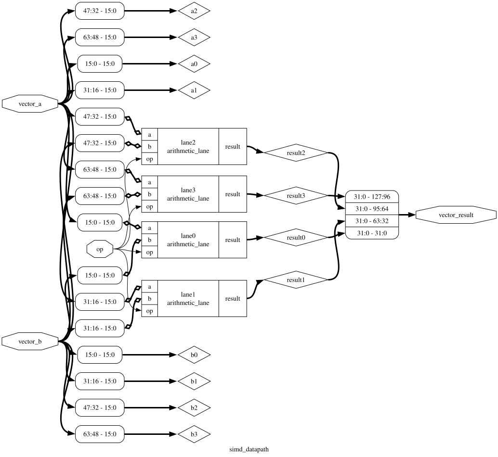

# MiniGPU-4 — 4-Lane SIMD Accelerator

MiniGPU-4 is a learning project for a four-lane SIMD arithmetic accelerator written in SystemVerilog. It explores signed vector arithmetic, register storage, instruction decoding, simulation, and synthesis.

> **Integration status:** The arithmetic lane, four-lane datapath, vector register file, and instruction controller are separate modules. They have module-level tests, but are not yet integrated into a complete processor datapath. In particular, the datapath produces four 32-bit results (128 bits total), while each vector register is 64 bits and holds four 16-bit elements. Packing the lower 16 bits from each lane for register writeback is planned work.

## Architecture

Each 64-bit input vector is split into four signed 16-bit lanes. Each lane performs ADD or MUL on the corresponding elements and produces a signed 32-bit result. The four results are concatenated into a 128-bit output.



The register file independently provides eight 64-bit registers, two combinational read ports, and one synchronous write port. The instruction controller independently sequences accepted instructions through `IDLE`, `EXECUTE`, and `WRITEBACK`.

## Hardware modules

| Module | Source | Function |
|---|---|---|
| `arithmetic_lane` | [`rtl/arithmetic_lane.sv`](rtl/arithmetic_lane.sv) | Signed 16-bit ADD/MUL lane with a 32-bit result. `op=0` selects ADD; `op=1` selects MUL. |
| `simd_datapath` | [`rtl/simd_datapath.sv`](rtl/simd_datapath.sv) | Splits two 64-bit vectors into four 16-bit lanes, instantiates four arithmetic lanes, and concatenates their results. |
| `vector_regfile` | [`rtl/vector_regfile.sv`](rtl/vector_regfile.sv) | Eight 64-bit registers, two asynchronous read ports, and one clocked write port. |
| `instruction_controller` | [`rtl/instruction_controller.sv`](rtl/instruction_controller.sv) | Captures supported instructions and generates read/write addresses and control signals over three states. |
| `mux2` | [`practice/mux2.sv`](practice/mux2.sv) | Two-input, one-bit mux used as a practice module. |

## Instruction format

The controller accepts `instruction_valid` separately from the instruction bits. The 11-bit instruction fields currently decoded by the RTL are:

| Bits | Field | Meaning |
|---|---|---|
| `[10:9]` | operation code | `2'b00` = ADD; `2'b01` = MUL. Other values are not accepted. |
| `[8:6]` | destination address | Three-bit vector-register address. |
| `[5:3]` | source A address | Three-bit vector-register address. |
| `[2:0]` | source B address | Three-bit vector-register address. |

The operation bit is `instruction[9]` (`0` for ADD, `1` for MUL). The controller holds the instruction and exposes source addresses during `EXECUTE`, then asserts `write_enable` and the destination address during `WRITEBACK`. There is not yet a top-level module connecting these signals to the datapath and register file.

## Tools

- SystemVerilog
- GNU Make
- Verilator 5.x for compilation, simulation, and lint
- GTKWave for VCD waveform inspection
- Yosys and Graphviz for synthesis exploration and SVG schematics

## Build, simulation, and lint

Run commands from the repository root in WSL Ubuntu.

The existing Makefile provides:

```bash
make test        # Run the MUX, arithmetic-lane, register-file, and controller tests
make mux         # Run the MUX test
make arithmetic  # Run the arithmetic-lane test
make regfile     # Run the register-file test
make controller  # Run the instruction-controller test (also writes sim/instruction_controller.vcd)
make lint        # Lint the MUX, arithmetic lane, register file, and instruction controller
make clean       # Remove Makefile-managed Verilator build directories
```

The SIMD datapath testbench is present and can be built and run separately:

```bash
verilator --binary --timing -Wall \
  --top-module tb_simd_datapath \
  --Mdir sim/obj_simd_datapath \
  rtl/arithmetic_lane.sv rtl/simd_datapath.sv tb/tb_simd_datapath.sv
./sim/obj_simd_datapath/Vtb_simd_datapath
```

The SIMD datapath can also be linted directly:

```bash
verilator --lint-only -Wall --top-module simd_datapath \
  rtl/arithmetic_lane.sv rtl/simd_datapath.sv
```

To inspect the controller waveform after running `make controller`:

```bash
gtkwave sim/instruction_controller.vcd
```

For Yosys synthesis and an updated datapath schematic:

```bash
mkdir -p schematics
yosys -p 'read_verilog -sv rtl/arithmetic_lane.sv rtl/simd_datapath.sv; hierarchy -check -top simd_datapath; synth -top simd_datapath; stat; show -format svg -prefix schematics/simd_datapath simd_datapath'
```

The SVG is a generic synthesized-logic view, not a technology-mapped FPGA or ASIC implementation.

## Verification status

The current testbenches exercise:

- All select/input combinations for the 2:1 MUX.
- Signed ADD and MUL cases in one arithmetic lane.
- Register-file writes, retention, and reads.
- ADD and MUL controller execution/writeback sequencing.
- ADD and MUL on all four SIMD datapath lanes.

`make test` covers the first four testbenches. The SIMD datapath bench is currently run separately using the command above. These simulations do not verify an integrated MiniGPU-4 system or an FPGA implementation.

**Known lint warning:** `make lint` currently stops at the controller because Verilator reports the unused `instruction_reg[10]` bit. The RTL is left unchanged; this warning should be reviewed as the instruction format is finalized.

## Project layout

```text
MiniGPU-4/
├── docs/                 # Project documentation
├── practice/             # MUX exercise and testbench
├── rtl/                  # Arithmetic, SIMD, register-file, and controller RTL
├── schematics/           # Generated architecture/gate-level diagrams
├── sim/                  # Simulation outputs and Verilator build directories
├── tb/                   # SystemVerilog testbenches
└── Makefile              # Simulation, lint, and cleanup targets
```

The local `docs/` directory is currently empty, so Git will not include it until a file is added. Generated simulator build directories, waveforms, and the synthesized netlist are ignored; RTL, testbenches, and schematic diagrams are retained.

## Planned milestones

1. Define and implement explicit packing of the four 32-bit lane results into a 64-bit vector-register writeback value (four lower 16-bit lane results).
2. Connect the instruction controller, SIMD datapath, and vector register file in a top-level module.
3. Add integrated tests for instruction fetch/execute/writeback, register updates, and operation edge cases.
4. Explore FPGA synthesis, timing, and deployment after integration is verified.

## Updating the GitHub copy

Check what changed before staging:

```bash
git status --short
git diff
```

Then stage, commit, and push updates:

```bash
git add .
git commit -m "Describe the changes"
git push
```
